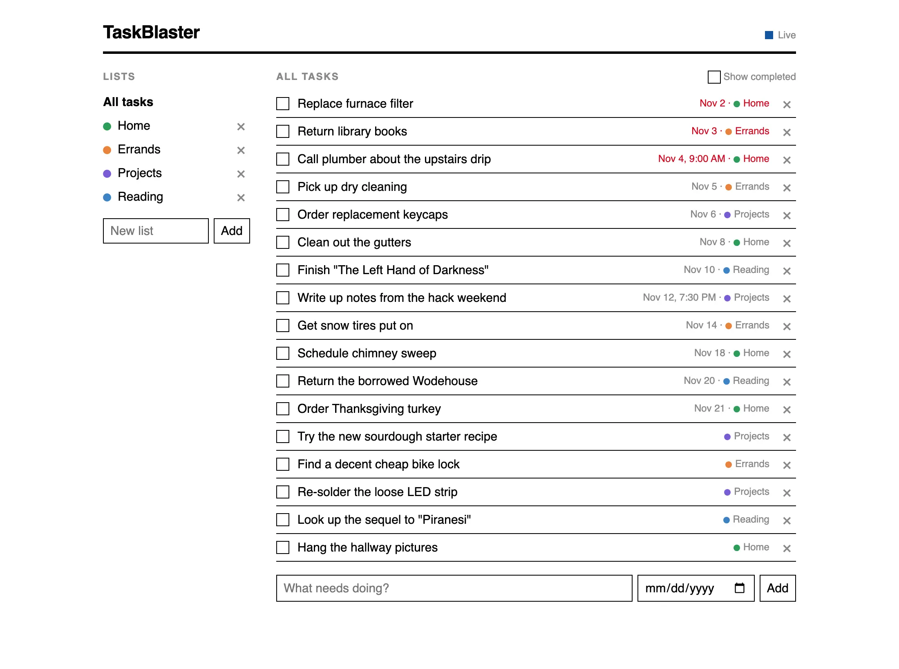

It's been nearly eight months since "[building my todo list
app](https://rjbs.cloud/blog/2026/03/building-my-todo-list/)".  Did you forget
what that was?  Probably, because although I talk about it in person all the
time ("I made this cool thing!"), I haven't blogged much about it.  I did some
more good stuff with it, though, so here's more blogging.

First, a long and luxurious intro.  Then, "what I did now".

**Recap**:  Everybody wants slightly different things out of their todo list.
They want something catered to just how they think about their work.  I'm part
of everybody, and I want a me-oriented tool, too.  I've used many different
systems, and for years knew what I wanted, but didn't feel it was worth
building it until I had a coding agent to greatly reduce the grunt work.  Once
I did, and once I had enough confidence in the agent, I used it to build
NerfJournal.  It's a bullet-journal style todo list, written in Swift.  Because
I barely understood Swift, I also had the agent build a "[Learning Swift by
Reading the NerfJournal Source](https://nerfjournal.rjbs.cloud/)" book, chapter
by chapter, based on my actual expertise and on my Q&A as I read each chapter.
This was a big success for me on multiple fronts.  I got a productivity tool
that has been a big help, I learned a lot more Swift, and I learned a lot more
about how to deploy a coding agent successfully.

I tweaked the app a few times, but nothing exciting.  I added a tiny feature or
two, I fixed some bugs.  Then for a few months, I just used it almost every
day, changing nothing.  Success!

**Lumps under the carpet**:  When I started building the app, I'd hoped I could
use EKReminder, the Apple EventKit representation of a iCalendar VTODO.
Problem was, EventKit didn't expose every part of VTODO, and I didn't just need
lots of standard properties, I also needed to add some custom extensions.
Using JMAP for Tasks wasn't going to be much better, not to mention the fact
that JMAP for Tasks doesn't have a spec yet.  I had a Zoom call with some of my
Cyrus team colleagues, and we talked about how there wasn't really a "just use
the standard" solution.

Instead, I built a custom data model that serialized into GRDB, which is just a
popular SQLite-backed storage engine.  This worked fine… but it also meant
building some extra interfaces for dealing with the data from outside the GUI
app.  Originally, I thought about making the whole thing AppleScript enabled,
but I settled on a CLI app, which I could also drive from my personal "work
helper" swiss army knife MCP.  Fine, but it all had to run on my laptop.  This
felt like a clear sign that things were not put together correctly.

The Silver Bullet:  For a long time, the `:jmap:` emoji in work's Slack was a
little silver bullet.  That's because JMAP can fix any problem (except too much
JMAP (or werewolves)).  If I could convert NerfJournal to use JMAP for Tasks,
it would have no problems, right?

Seriously, though, it would solve two real problems: how to access my work
journal from two devices (like my phone and laptop) *and* how to interact with
my todo list more programmatically without an intervening command line program.

**What I did**:  First, I sat down very still and quiet and thought about the
things keeping me from using VTODO.  There had been a small handful at the
outset, but over time, some of the features had changed, and now there were
fewer blockers.  I wrote down some notes, then asked Claude what prevented me
from using VTODO.  It produced a list, and we went back and forth.  Most of its
objections, I had already anticipated.  Others I either accepted or rejected.
Then we translated the whole conversation into JSCalendar terms.

The specifics aren't terribly interesting, but I ended up needing two new
custom properties:

* `autoCancel` - whether a todo should be cancelled automatically when it's no
  longer the day on which the event started
* `endedAt` - the date on which an event was marked completed, cancelled, or
  failed.

Really, the endedAt could *maybe* have be replaced by progressUpdated… but that
was removed between JSCalendar 1.0 and 2.0, as part of a totally reasonable
reduction of scope.  (Ask me about JSCalendar scope, sometime, when there is
beer.)  The output of this conversation was the
[JMAP-SPEC](https://github.com/rjbs/NerfJournal/blob/main/JMAP-SPEC.md) doc, a
road map for "how to map our existing months of data to JSTasks".

The good news is that this meant the whole app could be moved to JMAP for
Tasks.  The bad news is that there was no way to use that.  Cyrus doesn't yet
support JMAP for Tasks, in part because there isn't a good spec yet.  So, first
off, I produced a new draft of a spec.  (Expect another blog post about that
someday, maybe.)  Then I started a new Claude session.  I didn't quite say
"Produce a JMAP for Tasks server, matching this spec, as quick and dirty as you
can," but… it wasn't too far off.  The goal here was to roughly have JMAP for
Tasks, not to have something that would store customer data or handle all the
weird edges.

To test the client out, I also said, much closer to literally, "Produce a
single page web client for JMAP for Tasks, matching this spec, as quick and
dirty as you can".  This was a prototype for testing a prototype.  An ur-type,
if you will.  (I will avoid making this post *much* longer than it already is
but Claude's view of MVP is so weird, in a good way.  "Obviously I have already
implemented EventSource in both client and server, but I'm guessing you don't
need PushSubscriptions.  Let me know.")

So, with a working server in hand, the next step was to port the data and sync
engine.  Long story short, **I ported the data and sync engines to JMAP for
Tasks**.  More on that whole subject in a few weeks…  because the final
exciting thing is actually a bit of a left turn into "cool commodity software
you may not know about".  It's Tailscale — but don't skip past this unless you
know Tailscale better than I did a few weeks ago.  It does a lot.

## Hosting and authentication

At this point, I had a JMAP for Tasks server I could run on the Internet and
sync to.  Cool.  This meant it would need authentication and other security.  I
figured I'd use Passkey for everything, but this would really mean Passkey and
OAuth, and of course I could do that but at some point it's just a pain in the
butt and I would be annoyed.  Instead, **here is how I secured the whole system
with Tailscale**:

Tailscale is a (partly) p2p virtual private mesh network.  You authenticate
your computer to your tailnet via one of several means, and then that computer
gets a network interface onto your private network.  They get IPs in 100.64/10
space, which is defined by [RFC 6598](https://www.rfc-editor.org/info/rfc6598/)
for non-globally-routable space.  If you know one of your machine's Tailnet
IPs, you can connect to it.

If you don't, you can use Tailscale MagicDNS.  It's what it sounds like: your
machines automatically register their names in a Tailscale-managed domain.  So,
I connect my laptop "tove" to my Tailnet and get the name tove.tailXXXXX.ts.net

Once you've got a DNS name managed for you, what next?  How about Let's
Encrypt.  With MagicDNS enabled, you can request that Tailscale supply you with
a LE-signed TLS certificate.

Next, let's say you're like me and you want to write a bunch of HTTPS services
and run them on one machine, but you don't want to put a proxy in front of
them.  You've only got one Tailnet IP, so you can only have one listener on
post 443.  *Except*, Tailscale lets you register per-service IPs, which then
use userspace TCP/IP to let the server itself get itself routed.

Putting it all together:

* I run a little daemon on my desktop or Droplet
* That daemon uses Tailscale (the Go tsnet module) to get an IP on my Tailnet.
* The IP is given the MagicDNS name of my choice, like "jmap-for-tasks"
* The service then requests a TLS certificate
* With all that done, the service binds to :443 on that IP, with that cert, and
  can serve JMAP for Tasks over HTTPS on my VPN

But what about authentication?  Well, because every peer on the Tailnet has
authenticated through Tailscale, you can ask Tailscale to tell you who the
authenticated user for the peer is.  In other words, I don't use any kind of
HTTP authentication to talk to my JMAP for Tasks server.  I talk to it on its
Tailnet name (which my client doesn't need to understand as anything but a DNS
name) and the server says "Oh, that's rjbs."  My Tailscale identity is
registered with the server just like a Passkey would be.

**Finally**:  I can't show you a cool screenshot here, because the application
looks absolutely the same as in my last post about it.  It still works offline,
it still has all its historical data, and no features were lost.  It's just a
whole lot better, and I'm going to build a lot more on the things I learned
doing this.  To celebrate, I watched [this mediocre King adaptation from the
80s](https://letterboxd.com/film/silver-bullet/).
